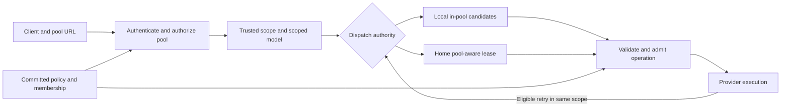

# Account pool isolation design

Status: target implementation specification. The local HTTP implementation, web panel, and
its explicit limitations are documented in [Account pools](account-pools.md).
This document also specifies later work (Home protocol, stateful adapters,
batch membership operations, durable revision/audit records, and
pool accounting dashboards); those contracts are not all implemented by this PR.
The full production acceptance matrix below remains a release gate for that wider
scope. Do not infer implementation status from a proposed API in this document.

Date: 2026-11-13. Source baseline:
`ae627ddbee3a51979fd1dfa6d9d4b6fa543477db`.

CPA will select upstream credentials inside an explicitly selected account pool.
Each pool has its own URL prefix. A shared client API key can access several pools,
or a client key can be restricted to specific pools. Selection, retries, model
discovery, continuations, resource retrieval, and remote dispatch must enforce the
same boundary.

This specification is for backend, management UI, Home, and test implementers.
Production readiness requires the release gates in this document; completing the
design does not establish that an implementation passes them.

## Contents

- [Scope and decisions](#scope-and-decisions)
- [Current implementation](#current-implementation)
- [Isolation invariants](#isolation-invariants)
- [Configuration and identity](#configuration-and-identity)
- [Public routes and authorization](#public-routes-and-authorization)
- [Request admission and scheduling](#request-admission-and-scheduling)
- [Models and capabilities](#models-and-capabilities)
- [Sessions connections and resources](#sessions-connections-and-resources)
- [Persistence and concurrent changes](#persistence-and-concurrent-changes)
- [Home protocol](#home-protocol)
- [Plugins and SDK integration](#plugins-and-sdk-integration)
- [Management API](#management-api)
- [Management interface](#management-interface)
- [Errors and recovery](#errors-and-recovery)
- [Observability and accounting](#observability-and-accounting)
- [Deployment migration and rollback](#deployment-migration-and-rollback)
- [Implementation work packages](#implementation-work-packages)
- [Verification and release gates](#verification-and-release-gates)
- [Operational procedures](#operational-procedures)

## Scope and decisions

### Required behavior

1. A request to `/pools/plus/v1/responses` can use only credentials assigned to
   `plus`, including every retry and continuation.
2. A request to `/pools/pro/v1/responses` uses only `pro`. The model name in the
   business payload does not change merely because the pool changes.
3. Existing provider capabilities, model aliases, thinking settings, payload
   rules, credential priorities, weights, cooldowns, and concurrency policies
   still apply within the selected pool.
4. Multiple client keys and one shared key are both supported. The URL chooses a
   pool; the authenticated principal's grant determines whether it is accessible.
5. Pool membership, definitions, and grants survive restart. Changes have explicit
   concurrency, persistence, and activation semantics.
6. Every inference-capable route is either integrated with pool enforcement or
   rejected in pooled mode. There is no unrestricted alternative route.

### Initial release decisions

| Subject | Decision |
| --- | --- |
| Isolation unit | One runtime credential belongs to zero or one pool. Unassigned credentials cannot serve pooled traffic. |
| URL | Fixed `/pools/{pool_id}` namespace; no arbitrary user-defined path templates. |
| Pool identifiers | Immutable lowercase slugs. Display names can change. |
| Pool lifecycle | Create, update, enable, and disable. No hard deletion or ID recycling in the initial release. |
| Ownership | One shared auth manager, executor registry, and credential lifecycle. Do not instantiate a manager per pool. |
| Selection | Filter by pool before priority, weight, transport preference, or affinity. Partition scheduling cursors by pool. |
| Exhaustion | Retry within the pool under existing retry rules, then return an error. No implicit cross-pool failover. |
| Existing addresses | Explicit default-pool mapping or rejection after pooling is enabled. Never mean all pools. |
| Existing installation | Pooling is disabled by default. Enabling or disabling it requires a controlled restart. |
| Classification | Explicit membership is authoritative. Subscription tier can assist a reviewed batch assignment. |
| Administration | Use `/v8/management` only for new functionality. |
| Home deployment | Home is authoritative; capability negotiation and coordinated Home changes are required. |

The feature does not add subscription billing, per-pool monetary budgets, automatic
upstream subscription upgrades, a new protocol translator, or a sandbox for native
plugins. Pool authorization controls CPA's use of credentials; it does not revoke
upstream access outside CPA.

Strict enforcement is required for all shipped native adapters. An optional
plugin, relay, or remote adapter that lacks enforcement must be unavailable in
pooled mode, with an explicit capability error rather than unrestricted fallback.

### Credential identity and account identity

The routing identity is `Auth.ID`. An upstream account may have more than one
credential record, so assigning one record does not prove physical account
exclusivity by itself.

Use a verified provider-scoped account or organization/project identity to detect
known duplicate accounts. Equal email addresses or labels are insufficient.
Reject an assignment that places known duplicates in different pools. Discovery
of such a conflict during reload quarantines the conflicting records from new
admissions until the operator resolves it. An accounting label or an editable
usage-account binding is not authorization evidence.

Where an upstream does not expose a stable identity, the guaranteed boundary is
credential membership. The import preview must mark identity as unverified and
require operator reconciliation before claiming account-level exclusivity.
Tokens and raw client keys must not appear in the conflict report.

## Current implementation

The following are existing integration points, not proposed behavior:

| Area | Source and implication |
| --- | --- |
| Frontend authentication | [Config provider](../internal/access/config_access/provider.go) validates a set of client keys. [Access results](../sdk/access/registry.go) contain principal and metadata, without a typed pool grant. |
| Public routes | [Route registration](../internal/api/server_routes.go) exposes `/v1`, `/v1beta`, `/openai/v1`, Codex direct aliases, realtime routes, and attachable WebSocket routes. |
| Execution context | [Handler metadata](../sdk/api/handlers/handlers.go) propagates caller scope, request path, pinned auth, and execution-session identity. |
| Candidate eligibility | [Selection](../sdk/cliproxy/auth/conductor_selection.go) centralizes credential-kind and other eligibility checks. |
| Fast scheduling | [Scheduler](../sdk/cliproxy/auth/scheduler.go) has provider/model shards and filtered selection. Pool identity must also partition ordering state. |
| Execution and retries | [Execution](../sdk/cliproxy/auth/conductor_execution.go) handles ordinary, streaming, count, and retry flows. |
| Alternative selection | [Home and credits paths](../sdk/cliproxy/auth/conductor_home.go) include remote selection and an Antigravity credits candidate scan. The latter does not currently use the common eligibility predicate. |
| Models | [Model registration](../sdk/cliproxy/service_models.go) applies model-name prefixes; [OpenAI models](../sdk/api/handlers/openai/openai_handlers.go) reads a global catalog. |
| Credentials | [File synthesis](../internal/watcher/synthesizer/file.go) parses OAuth metadata, including Codex plan type. [Lifecycle updates](../sdk/cliproxy/auth/conductor_lifecycle.go) provide mutation and persistence ordering. |
| Stateful routes | [Responses WebSocket](../sdk/api/handlers/openai/openai_responses_websocket.go), [video handlers](../sdk/api/handlers/openai/openai_videos_handlers.go), and [realtime secrets](../internal/client/codex/live/client_secret.go) retain identities or credentials beyond a single request. |
| Home wire contract | [Requests](../internal/home/requests.go) contain model, session, retry, exclusion, and pinned-auth fields, but no explicit pool contract. |
| Management | [v8 routes](../internal/api/server_management_v8.go) and [config writes](../internal/api/handlers/management/config_v8.go) provide the current management surface and config ETags. |
| Usage | [Usage records](../sdk/cliproxy/usage/manager.go) and [accounting events](../internal/accounting/types.go) need immutable pool attribution. |
| Panel | [Panel build](../web/management/README.md) uses pinned upstream source with patches and an overlay. |

Existing model `prefix`, upstream model pools, and HTTP connection pools are
separate concepts. None is the account-pool authorization boundary.

The scoped request path separates pool policy from provider payload translation:



## Isolation invariants

These invariants are mandatory and are referenced by the verification matrix.

| ID | Invariant |
| --- | --- |
| I1 | In pooled mode, every admitted business operation has exactly one validated pool and one authenticated principal. |
| I2 | At admission, the selected credential belongs to that pool, is eligible for the operation, and the current principal grant permits it. |
| I3 | Retries, alternate models/providers, fallback code, plugin delegation, and remote dispatch cannot widen the pool. |
| I4 | A pin, affinity hit, cached object, or retained connection never overrides current eligibility or authorization. |
| I5 | Metadata received from a client, a request body, query fields, or an ordinary forwarding header cannot manufacture a trusted pool scope. |
| I6 | One committed control-plane revision is used for each decision. Partially applied configuration cannot enable admissions. |
| I7 | A successful membership mutation means persistence and runtime publication both completed. Ambiguous persistence leaves affected credentials fenced. |
| I8 | A credential cannot admit work in its destination pool until its source-pool operations and retained upstream leases have drained. |
| I9 | Model discovery, capability projection, and automatic model resolution consider only the current pool. |
| I10 | Usage retains the pool at admission, even if membership changes later. |
| I11 | Pool-aware requests never downgrade to a legacy unscoped Home, plugin, SDK, or route path. |
| I12 | When pooling is disabled, existing supported behavior remains compatible and pooled routes are unavailable. |

An admission is the atomic authorization to start one upstream business operation.
An operation admitted before a pool disable or grant revocation can finish in its
original scope. Each subsequent retry, turn, resource operation, or new subrequest
requires admission again. Disabling a pool is not retroactive cancellation.

## Configuration and identity

### Canonical v8 configuration

All new fields below are proposed. They must be added to runtime types, strict
validation, v8 layout projection, serialization, reload, and management schemas
together. Unknown fields under the new structures are errors.

The example preserves a shared key and optionally adds a restricted application:

```yaml
config-version: 8

access:
  api-keys:
    - "example-existing-shared-key"
  legacy-key-pools: [default, plus, pro, team]
  clients:
    - id: plus-app
      api-key: "example-plus-app-key"
      enabled: true
      allowed-pools: [plus]

routing:
  strategy: round-robin
  account-pools:
    enabled: true
    unscoped:
      mode: default
      pool-id: default
    pools:
      - id: default
        name: Default
        enabled: true
      - id: plus
        name: Codex Plus
        enabled: true
        strategy: round-robin
      - id: pro
        name: Codex Pro
        enabled: true
        strategy: weighted-round-robin
      - id: team
        name: Codex Team
        enabled: true
```

For deployments requiring explicit addresses, configure:

```yaml
routing:
  account-pools:
    enabled: true
    unscoped:
      mode: deny
```

| Field | Contract |
| --- | --- |
| `routing.account-pools.enabled` | Defaults to `false`. Changing the active mode requires restart; live writes attempting a mode change return `restart_required` without applying it. An external file change is reported as pending restart. |
| `unscoped.mode` | `deny` or `default`. Defaults to `deny` when pooling is enabled. |
| `unscoped.pool-id` | Required only for `default` mode; must identify a defined, enabled pool. Forbidden in `deny` mode. |
| `pools[].id` | Unique, immutable, matches `^[a-z][a-z0-9-]{0,47}$`. No case folding, URL decoding, or whitespace repair at validation. |
| `pools[].name` | Required display name, 1–100 Unicode characters after trimming; control characters rejected. |
| `pools[].enabled` | Required boolean. Disabling rejects new admissions; it does not move members. |
| `pools[].strategy` | Optional. Inherits `routing.strategy` when omitted; supports existing round-robin, weighted-round-robin, and fill-first strategies. |
| `access.legacy-key-pools` | Explicit grants shared by all legacy `access.api-keys`. Omitted or empty grants no pool access. |
| `access.clients[].id` | Unique stable client identifier using the pool-ID character rules. It is not a secret. |
| `access.clients[].api-key` | Client secret, handled by the existing configuration secret protections. Must not duplicate another native client key after resolution. |
| `access.clients[].enabled` | Optional, defaults to `true`. |
| `access.clients[].allowed-pools` | Explicit list of pool IDs or the single value `"*"`. Empty means no access; wildcard cannot be mixed with named pools. |
| `access.provider-clients[].provider` | Registered frontend-auth provider identifier. Required together with a stable authenticated client ID. |
| `access.provider-clients[].id` | Client ID supplied by that provider under the versioned identity contract; unique within the provider. |
| `access.provider-clients[].enabled` | Optional, defaults to `true`. |
| `access.provider-clients[].allowed-pools` | Host-owned grant with the same semantics as native structured clients. There is no secret in this mapping. |

Explicit `"*"` also grants future pools. The panel must explain that consequence.
Named grants can reference disabled pools, but must reference defined pools.
Legacy-key grants use the same named-list or single-wildcard syntax. Provider
clients are optional; native key deployments need no plugin mapping.
Enabling pooled mode without any configured authentication provider is invalid;
the current unauthenticated-manager shortcut must not enable public pool access.

Configuration limits for the initial implementation are 1,024 pool definitions,
10,000 native/provider client entries combined, and 1,024 named grants per
principal. They bound parser work and indexes; they are not demonstrated
throughput claims. Preserve existing stricter request-size or credential limits.

Structured clients and legacy grants are validated while pooling is disabled so
an operator can stage migration. In disabled mode, legacy keys retain existing
semantics and enabled structured client keys authenticate like legacy keys.
The `allowed-pools` lists become authorization constraints only in pooled mode.
The UI must make this mode distinction explicit.

### Membership storage

Add `Auth.PoolID` as the normalized runtime field. Preserve its value on cloning,
refresh, prepared-auth merges, relogin, persistence, and configuration reload.
There must be one authoritative persisted membership for each source type.

| Credential source | Authoritative representation |
| --- | --- |
| OAuth or file credential | Top-level JSON `pool_id` in the existing auth record. |
| Configured upstream API key | `pool-id` on the v8 upstream group/key; per-key value overrides the group. |
| Plugin-managed persisted auth | Host-validated `pool_id` on the persisted auth record. |
| Plugin virtual auth | Inherits its concrete parent membership; cannot override it. A parentless virtual auth is ineligible until the host can assign an explicit validated scope. |
| Home credential | Home-owned membership and membership revision from the pool-aware dispatch contract. |

OAuth metadata example, omitting all token fields:

```json
{
  "type": "codex",
  "pool_id": "plus"
}
```

In v8 API-key groups, absent or `null` per-key `pool-id` inherits the group.
An explicit empty string leaves the key unassigned. An absent group value also
means unassigned. OAuth `pool_id` must be a valid slug or an empty string;
`null` is rejected. These rules must survive load/save round trips.

In pooled mode, missing membership never implies `default` or all accounts.
Existing accounts are assigned explicitly during migration. New OAuth logins and
imports accept a management-supplied pool ID; choosing to leave them unassigned
keeps them out of traffic.

Membership is routing configuration, not token state. Token refresh and relogin
must not restore an older membership over a concurrent operator update. A malformed
or unknown membership loaded from an auth file quarantines that record and
produces an operator-visible error; it cannot silently become unassigned/default
and continue under a different policy.

### Subscription tiers

Use observed `plan_type` to filter and preview assignments, not to change
membership on every request. Automatic reassignment following a token refresh is
outside the initial release. Unknown or ambiguous tier remains unclassified.

The current Codex model-catalog fallback to Pro capabilities is not evidence of a
Pro subscription and must not be reused as an automatic Pro-pool assignment rule.
Pool names do not grant capabilities that the selected account lacks.

### Trusted runtime scope

Introduce a typed, immutable request scope in `sdk/cliproxy` shared infrastructure,
with pool-specific implementation outside executor files. It carries:

- Mode, pool ID, authenticated provider, and stable principal scope.
- Authentication binding/version, so a rotated or removed key cannot remain
  authorized merely because its client ID still exists.
- Policy revision observed at entry and the canonical operation path.
- A request or trace identifier for audit correlation.

The authoritative scope is placed in `context.Context` by host code. Metadata
may contain read-only copies for logs and plugins, but selection must not trust
metadata in preference to the typed context. Missing scope is an error when the
manager is configured for pooled mode.

Preserve existing `Result.Principal` and usage semantics while introducing a
typed pool grant and optional stable client ID. Do not globally replace an
existing raw-key principal with a client ID in a way that changes accounting or
WebSocket identity comparisons. Derive a non-secret scope for cache and audit keys.

## Public routes and authorization

### Route registration

Extract the existing inference route registration into reusable functions that
accept a router group and middleware. Register the legacy families and the fixed
`/pools/:pool_id` families once at startup. Pool additions update a validated
lookup table rather than mutating Gin's route tree while requests are running.

For example, the OpenAI client base URL is
`https://cpa.example.com/pools/plus/v1`. Claude clients use the same pool root with
their normal `/v1/messages` suffix, and Gemini retains its `/v1beta` paths.
Codex direct clients use `/pools/plus/backend-api/codex`. Deployment documentation
must distinguish a client's base URL from the complete endpoint it appends.

| Route family below the pool prefix | Required enforcement |
| --- | --- |
| `/v1/models` and model details | Scoped catalog, including Codex `client_version` variants and protocol-specific projections. |
| `/v1/chat/completions`, `/v1/completions` | Ordinary and SSE execution, stream bootstrap, retries. |
| `/v1/responses`, `/v1/responses/compact` | HTTP, WebSocket turns, compaction, replay, previous-response references. |
| `/v1/messages`, `/v1/messages/count_tokens` | Anthropic generation and counting. |
| `/v1beta/models/*`, `/v1beta/interactions` | Gemini lookup, generation, streaming, counting, and interactions. |
| `/backend-api/codex/*` | The existing direct responses, compact, and alpha-search aliases. |
| `/v1/alpha/search` | Direct credential selection and auxiliary work. |
| `/v1/images/*`, `/v1/audio/speech`, `/v1/tts` | Native and compatible generation, including helper/subrequests. |
| `/v1/videos*` and `/openai/v1/videos*` | Creation, edits, extensions, retrieval, and content downloads. |
| `/v1/live*` and `/v1/realtime*` | Handshakes, turns, ephemeral keys, sideband, and call control. |
| Attached relay/custom inference routes | Explicitly declare pool support; otherwise reject in pooled mode, including on an old unprefixed alias. |

OAuth callbacks, health endpoints, management routes, static assets, and internal
control-plane endpoints are not replicated below pool prefixes. Their existing
authentication and exposure rules remain separate.

Maintain an executable route inventory test. A newly registered inference route
must declare how it obtains scope or be denied under pooled mode. Do not rely on
developers remembering to wrap each new handler manually.

### Path handling

Keep the external path and the canonical operation path separately. For
`/pools/plus/v1/responses` they are, respectively, that complete path and
`/v1/responses`. Strip exactly one validated prefix for operation classification;
do not change the user's business payload or overwrite the original request URL.

Payload rules and built-in endpoint detection use the canonical operation path.
Audit logs use the external path plus pool ID. Plugin contracts expose both
explicitly, preserving the meaning of existing path fields for legacy requests.
This avoids breaking image rules or request-path matching after adding a prefix.

Reject invalid slugs, encoded separators within the pool segment, backslashes,
dot segments, repeated pool prefixes, and ambiguous prefix normalization.
Normalization or redirect behavior must never turn a pool route into an
unscoped route or into another pool. Preserve existing decoding rules for the
operation suffix, including Gemini model paths.

### Authorization order

1. Classify the route and parse the pool segment without accessing credentials.
2. Authenticate using the existing supported credential carriers. In pooled mode,
   absent auth providers or a nil successful identity cannot mean anonymous access.
3. Resolve the authenticated principal's grant from the active policy.
4. For an unscoped route, either reject or resolve its explicitly configured
   default pool. Do not infer a pool from a key's single grant.
5. Check the grant before returning pool metadata. An unauthorized pool selection
   returns `403` independently of whether the name exists.
6. Verify that the permitted pool exists and is enabled; create the trusted scope.
7. Resolve the scoped model and execute through admission.

Ordinary headers, query parameters, and JSON fields named `pool_id` are not
alternative selectors. Do not accept an internal admission token from the wire.
The public management key is not automatically an inference wildcard key.

## Request admission and scheduling

### Central eligibility

Extend the existing `authSelectionEligibility` mechanism with trusted pool
membership. Use the same predicate in legacy selection, scheduler fast paths,
mixed-provider selection, retry/cooldown calculations, pinned selection,
alternative-target checks, and credits candidate scans.

Eligibility is the conjunction of:

```text
current principal grant permits requested pool
AND pool is enabled
AND auth.pool_id equals requested pool
AND auth is not unassigned, quarantined, or under a membership mutation
AND existing credential policy, model, transport, status, and concurrency rules
```

Only the surviving candidates reach priority, weight, round-robin, or session
affinity logic. A high-priority credential in another pool is never a candidate.
An explicit pin outside the pool is rejected rather than silently converted into
an unrestricted selection. Recoverable stale affinity can choose another member
only if existing continuation semantics allow a full replay.

The Antigravity credits scan must call the same eligibility function before
consulting credits hints or invoking any executor. An executor route that skips
the normal manager requires the separate host admission contract described below.

### Final admission

Filtering a snapshot alone is insufficient: an account or grant can change
between selection and invocation. Introduce a host-owned admission guard shared
by the manager and direct native adapters.

Admission rechecks the latest policy, pool, selected credential, registration and
membership epochs, request requirements, and applicable concurrency permits.
For native keys, it also checks that the exact authenticated key binding remains
enabled in the current policy. Key rotation invalidates that binding without
requiring a change to the client's historical identity.
Under a short shared gate it records one active operation and issues an opaque
in-process ticket. Writers use the same gate to fence future admissions.

The ticket binds the pool, principal scope, auth ID, membership epoch, policy
revision, operation kind, and execution ID. It cannot be constructed from an
executor metadata map. No global manager lock is held during network I/O,
persistence, token acquisition, plugin calls, or streaming.

Use existing credential lifecycle/concurrency permits where possible, composing
the pool check without creating a second independent concurrency limit. Establish
and test a fixed lock order; invalidate snapshots before callbacks that can reenter
the manager. If a permit is obtained after a policy check, recheck policy before
the admission becomes valid.

Credential refresh/preparation may run between selection and admission. The
selected auth must be reread after preparation. A pool change causes rejection or
fresh in-pool selection; copying stale prepared auth must not restore membership.

Release the ticket exactly once on all success, error, disconnect, and cancellation
paths. Streaming tickets remain held until the upstream operation ends, not just
until an HTTP response header or stream object is returned. Auxiliary business
requests and SDK/plugin host subrequests obtain child admissions in the same pool.

### Retry and continuation semantics

Every upstream business attempt needs a fresh admission. This includes retries
inside executors and helper paths, transport reconnects that replay a business
request, stream bootstrap retries, and alternate upstream models.
An already established network connection does not authorize its next turn.

Retries retain the trusted pool and principal identity. They recheck current
membership and grants, preserve existing request-retry limits, and count only
in-pool credentials for max-retry-credentials and cooldown wait decisions.
Do not wait for another pool to recover. Cancellation ends the retry chain.

When all candidates are exhausted, preserve existing meaningful upstream terminal
errors where applicable; otherwise return the pool-local availability error.
Do not introduce a new execution timeout. Existing repository restrictions on
post-connection timeouts and WebSocket liveness exceptions remain in force.

### Scheduling state

Partition provider/model scheduling state, mixed-provider cursors, and weighted
credits by `(pool_id, provider, model)`. A filter over one global weighted cursor
is not enough to provide independent pool fairness.

Maintain per-pool auth indexes incrementally. Model registration, auth updates,
membership changes, and strategy changes advance the appropriate epoch.
Pool strategy changes invalidate only that pool's ordering state. Credential
cooldowns, refresh locks, and underlying quota state remain attached to the
credential identity, not cloned for each pool.

Pool configuration and scheduler publication must be coherent. A stale scheduler
can produce a stale candidate, but final admission must reject it. Bounded
resynchronization can retry the selection; it cannot relax eligibility.

## Models and capabilities

Keep one source registry and derive a pool-scoped view from its per-auth model
registrations. Do not duplicate credential lifecycle state or invent a new model
name merely to encode the URL pool.

- Model lists, details, Codex client catalogs, Claude projections, Gemini actions,
  and Home catalogs use the scoped view.
- `model=auto` resolves only among models in that view, with existing deterministic
  ordering. Empty views do not consult the global catalog.
- Provider routing and plugin model rewrites remain constrained by the selected
  pool. Model aliases and thinking suffixes are resolved under the existing rules.
- Existing credential model prefixes and `force-model-prefix` remain independent.
  Asking for another pool's model prefix cannot escape the URL pool.
- A client-visible model can remain listed while all of its members are cooling,
  consistently with current catalog semantics. Invocation then reports
  availability rather than pretending that the model disappeared.
- Aggregate capabilities must not be borrowed from other pools. For a model,
  intersect boolean capabilities and use the smallest known supported numeric
  limit across its enabled backing accounts that may be selected, including
  temporarily cooling accounts. Unknown values omit the uncertain capability
  rather than enlarging a limit. Disabled, quarantined, or unassigned accounts do
  not contribute. Verify context limits and tool support; stronger capability
  variants require an explicit model route whose candidate set supports them.

Cache scoped catalogs by pool, catalog/registration epoch, policy revision,
protocol/client-catalog variant, and any access-provider model-policy scope.
Invalidate on membership, disabled state, model registration, or policy changes.
A lookup from an untrusted pool string never creates an unbounded cache entry.

## Sessions connections and resources

### Namespace construction

All response-bearing or credential-binding state must incorporate the pool.
Use a versioned structured tuple or length-prefixed encoding, not ambiguous string
concatenation.

| State | Minimum scope |
| --- | --- |
| Explicit session affinity and parent/subagent lookup | Pool, principal scope, provider compatibility scope, model rules, session identity. |
| LCP or prompt-prefix affinity | Pool, principal scope, provider, model, existing prompt/environment identity. |
| Responses replay and previous-response bindings | Pool, principal scope, execution/response identity, selected auth and membership epoch. |
| Retained upstream WebSocket | Pool, principal scope, auth identity, membership epoch, execution-session identity. |
| Video/job IDs and download bindings | Pool, owner principal scope, external resource ID, creating auth and membership epoch. |
| Realtime client secrets and calls | Pool, issuer principal scope, issuer provider, call/session ID, existing expiry and limits. |
| Signature or provider-state cache | Preserve existing auth/model validity scope and add pool when state can influence a request, result, or credential binding. |

Inventory both local and KV-backed caches. Cache values also carry scope so a
mistaken key cannot silently authorize use. Credential token caches and refresh
locks stay keyed by credential; duplicating them by pool would permit conflicting
refreshes. Pure immutable model definitions can remain global.

Existing cache entries without a scope version are misses in pooled mode.
Never migrate a live unscoped credential binding by guessing its pool.

### WebSocket and realtime behavior

The connection's pool is fixed by its handshake address. Every turn uses the same
pool and reruns the existing authentication checks plus current pool authorization.
Neither an event payload nor a changed credential carrier may switch the pool.

Native passthrough, steering, compaction, continuation, upstream reconnect, and
alternative-auth detection must retain scope. Reuse the current turn-authorizer
hook and ensure it runs for paths that bypass ordinary handler execution.
Idle retained upstream connections must be invalidated on membership changes.

An established connection can finish its admitted turn after a grant is revoked
or a pool is disabled. The next turn is rejected. A connection-scoped upstream
continuation that cannot change auth must request the existing full-context replay
behavior; any replacement connection still targets the same pool.

Realtime ephemeral keys carry their issuer and pool binding in the local
authorization record. They cannot mint broader grants, and every use checks that
the issuer still has access. Sideband and call-control routes validate owner and
pool before looking up or using a retained credential. A live call holds an
upstream lease until it closes and therefore prevents moving its credential.

### Asynchronous resources

Creating a video or other asynchronous job records its pool and owner before
returning a usable ID to the client. Retrieval/content paths enforce that binding
before resolving the creating credential, including direct download helpers.
They cannot fall back to an arbitrary credential when a binding is absent.

A completed create request does not keep an admission open for the entire remote
job lifetime. A later retrieval is a new operation. Moving its credential
invalidates the old binding; the move preview must disclose the number of affected
resources. It does not move an upstream job or make it accessible from the new pool.

If the adapter promises restart continuity, its resource bindings require durable,
versioned storage with the same scope checks after restore. Where the current
adapter only promises an in-memory lifetime, restart may lose access, but must
return a scoped not-found result instead of reconstructing unrestricted access.
Never broaden the existing durability promise without implementing that storage.

## Persistence and concurrent changes

### State publication

Build a complete validated immutable policy snapshot containing definitions,
grants, and unscoped routing. Publish it atomically. Membership indexes reference
normalized auth state and an independently incremented membership epoch.

Expose an opaque runtime routing revision containing a process-unique epoch and a
monotonic sequence. It changes on effective policy or membership publication.
Restart changes the epoch, so outstanding optimistic-concurrency tokens fail
instead of matching reused counters.

Membership ETags contain a process epoch, auth registration identity, and a
membership generation. Increment the generation on every membership transition,
including A-to-B-to-A, but not on a token-only refresh. These are runtime control
tokens, not operator-editable credential JSON fields.

### Membership mutation

All paths that can change `pool_id` must use one mutation service: dedicated
management operations, generic v8 credential edits, config changes, imports,
watcher reloads, and SDK/host saves. The service must not depend on which HTTP
endpoint initiated the change.

For a single credential:

1. Validate the destination, source ownership, known-duplicate identity constraints,
   and the supplied membership ETag.
2. Acquire the existing per-auth mutation serialization, then place an admission
   fence under the short routing gate.
3. Close idle retained upstream connections and invalidate their bindings under
   the fence. If a business operation or live call lease remains active, remove
   the temporary fence and return `credential_busy` without changing membership.
   Operators can disable the credential, wait for it to drain, and retry.
   Closing an idle connection is not cancellation of an active turn.
4. Persist the latest credential with its new membership, preserving concurrently
   refreshed token fields. Config-sourced membership uses the config writer.
5. After confirmed durable success, publish the membership, indexes, and epochs;
   invalidate old bindings; clear the temporary fence.
6. Return success only when persistence and publication are both confirmed.

No lock covering the whole scheduler is held during persistence. The mutation
service must compose with existing registration epochs, file snapshot digests,
and refresh merging rather than adding an unrelated second writer.

Inside source mutation serialization, reread the authoritative source/version
before writing. If it differs from the snapshot used for validation, refresh and
revalidate rather than overwriting unseen token or membership changes. A remote
backend's commit/version checks apply in addition to local file-mirror checks.
This does not turn an unsupported multi-writer deployment into a supported one.

A definite pre-commit storage failure preserves the prior membership. An
ambiguous commit or failed publication leaves the record fenced, reports
`pool_state_unavailable`, and reconciles against the authoritative store.
Do not restore old runtime membership merely because a response was lost.

Batch moves are explicitly per-item atomic, not a distributed transaction across
auth files and config. Validate the envelope before changing any item; then return
each item's outcome and current revision. Other items may succeed if one is busy.
On a storage-wide failure, stop remaining writes and mark them unattempted.
Clients reconcile uncertain outcomes by reading state before retrying.

Known duplicate accounts spanning several records must first be drained and
unassigned as a group, then assigned to one destination. Intermediate unassigned
records cannot serve traffic. The panel must not imply an all-or-nothing batch.

### Reload and recovery

An invalid config reload retains the last committed policy and exposes a reload
failure; it never publishes an empty grant table as a permissive default.
An external membership change observed while its credential is busy fences new
admissions and remains pending until the old operations drain. It cannot be
activated early. Display both effective and pending membership to operators.

Boot reconstructs memberships and indexes before admitting pooled traffic.
Malformed records, identity conflicts, or missing definitions quarantine affected
credentials. Loss of the policy snapshot itself prevents pooled readiness.
Existing `/healthz` liveness remains separate from routing readiness.

### Storage and deployment guarantees

| Storage or topology | Required behavior |
| --- | --- |
| Local file | Write a restricted-permission temporary file in the same directory, sync and close it, atomically replace the record, and sync the containing directory where supported. Propagate errors, serialize writes, and preserve non-token metadata. |
| Postgres | Persist the credential/config mutation transactionally; propagate commit errors before runtime success. |
| Git or object store | A local mirror write is not authoritative success if remote persistence failed. Fence ambiguous changes and reconcile remote state. |
| Standalone single process | Runtime revision and admission gate define activation ordering. |
| Multiple independent CPA processes | Shared credential storage alone does not coordinate grants, sessions, or admission. Live cross-node membership changes are unsupported without a deployment barrier. |
| Home fleet | Home supplies authoritative admission, membership revisions, revocation, and draining across nodes. |

For a standalone fleet, drain every affected node, apply and verify the same
snapshot on all nodes, invalidate old sessions, and admit traffic only after all
required nodes acknowledge it. Nodes that cannot acknowledge stay out of the
load balancer. Do not describe a Postgres/Git/object backend as automatic
distributed pool consistency.

## Home protocol

The CPA baseline delegates selection to Home before normal local candidate
selection. Adding local filters alone cannot implement the Home guarantee.
The corresponding CLIProxyAPIHome implementation is a separate required work
package; its repository is not present in this workspace.

### Capability and authority

Define a negotiated capability `account-pools/v1`. Pooling cannot become ready
against Home until both ends support it. Existing interfaces that omit pool
fields must never be used as fallback for a scoped request.

Home owns pool definitions, grants, memberships, and remote admission revisions.
CPA must not override those with local YAML. The existing local-management
restriction in Home mode remains. Home validates the authenticated dispatching
CPA and the mapped access-provider/principal identity against its current policy;
it must not trust a client-supplied pool header.

Add these typed fields to dispatch and scoped-model requests:

| Field | Meaning |
| --- | --- |
| `pool_protocol` | Required integer `1` for scoped requests. |
| `pool_id` | Exactly one validated pool slug. |
| `client_scope` | Host-authenticated principal scope, not an arbitrary forwarded header. |
| `access_provider` | Identity authority used to authenticate the client. |
| `policy_revision` | Home policy revision observed by CPA; Home revalidates against its current policy. |

Home dispatch responses must echo the protocol and pool and attach authoritative
`policy_revision` and `membership_revision` to the selected credential/lease.
Existing exclusion, retry-round, pinned-auth, credential-policy, hierarchy,
concurrency, and selection-lifecycle fields remain part of the operation.
Pool constraints apply when selecting candidates, before a remote lease is issued.

For a Home request, its remote admission lease is the authority; CPA's final guard
validates that lease and adds local lifecycle accounting without independently
overriding the remote policy. A local membership snapshot cannot authorize a
credential that Home refused.

CPA validates every returned credential against the requested pool, echoed
protocol, and lease contract. A missing or mismatched scope releases the lease
through the existing lifecycle, records an invariant violation, and returns an
error without invoking an executor.

Home returns a structured `pool_access_denied`, `pool_disabled`,
`model_not_in_pool`, `pool_no_eligible_credentials`, or
`pool_protocol_unsupported` result. Unknown revisions trigger policy
resynchronization and authorization again, not local unscoped execution.

### Retained leases and updates

Retaining an auth snapshot is not retaining unlimited admission. Before another
business turn or subrequest, the Home authority must validate the current pool and
grant under the existing concurrency protocol. Invalidated or lost leases cannot
be rescued by local candidate selection.

A move fences the credential across the fleet. Home waits for all admitted work
and live leases to end, or returns busy; disconnected/stale nodes are handled by
the existing authoritative concurrency and reclaim rules. No new network timeout
is introduced by this feature.

Home must update scoped model catalogs, cache namespaces, client-secret and
resource bindings where it owns them, usage attribution, management UI, and
readiness reporting. A Home model response must carry an equivalent scope proof.

An integration fixture must cover old CPA/new Home, new CPA/old Home, and new/new.
Legacy mode remains compatible. Scoped mode with either unsupported participant
fails closed. The wire additions are proposed here; the coordinated Home change
and compatibility tests are release dependencies, not assumed completed work.

## Plugins and SDK integration

### Plugins

| Extension point | Required contract in pooled mode |
| --- | --- |
| Frontend auth | Supply a stable authenticated client ID under the versioned identity contract. Resolve its grant from `access.provider-clients`; no default wildcard for existing plugins. |
| Scheduler | Receive only in-pool candidates. Host verifies the returned ID and applies final admission, including built-in delegation. |
| Model router | May alter the model/provider within scope. Routing to a private executor still requires the executor contract. |
| Executor | Must execute an admitted host credential, or make a host execution callback that inherits and revalidates scope. A private credential store with no enforceable membership is unsupported. |
| Request/response interceptor | Cannot replace trusted scope. Read-only pool metadata is informational; canonical path matching remains stable. |
| Auth persistence callback | Uses the membership mutation service and cannot overwrite a host-owned pool assignment through a stale token refresh. |
| Usage callback | Receives immutable pool attribution copied from admission, not inferred from the current auth record. |
| Custom HTTP/relay route | Declares and enforces a scope adapter. Otherwise unavailable when pooling is enabled. |

Add versioned capability fields and rebuild Go plugins as required by the existing
plugin ABI/build contract. Merely declaring a capability does not authorize
arbitrary credential selection; the host still validates what it can enforce.
Native in-process plugins remain trusted code with host privileges. This feature
does not claim to contain a malicious native plugin.

For frontend auth, extend the typed response with `ClientID` while preserving
`Principal` for compatibility. The host obtains `provider` from the registered
adapter, matches `(provider, ClientID)` to an enabled provider-client entry, and
builds the grant from its committed policy. A plugin response cannot choose a
different provider or widen the configured grant through metadata. Missing
identity capability is `pool_adapter_unsupported`; a valid identity without a
host grant is `pool_access_denied`. Grant changes use the same admission gate and
revision semantics as native keys.

For example, this proposed mapping authorizes a plugin-authenticated identity:

```yaml
access:
  provider-clients:
    - provider: company-auth
      id: internal-plus-app
      enabled: true
      allowed-pools: [plus]
```

When a frontend-auth plugin is exclusive, absence of a pool grant must not fall
back to the inline native provider. An unsupported plugin route returns
`pool_adapter_unsupported` and does not attempt the same request through a global
provider. Existing disabled-pooling behavior is preserved.

### SDK

Provide a documented host API to resolve a pool scope from an authenticated
principal, or construct an explicitly trusted internal administrative scope.
Pooled managers reject `Execute`, `ExecuteStream`, `ExecuteCount`, and
`SelectAuth*` without a valid scope.

Internal background credential acquisition/refresh does not become user inference.
Operator-triggered verification uses an explicit privileged operation bound to
the target auth's current pool and an administrative audit identity. It cannot
reuse a public request's metadata to manufacture a bypass.

Scope inherited by plugin host callbacks, delegated tasks, or auxiliary model
requests is immutable. An internal caller wishing to use another pool must create
a separate explicitly authorized top-level operation, not widen a child request.

## Management API

All paths in this section are relative to `/v8/management` and require existing
management authentication. They are proposed additions or extensions.

### Configuration and overview

| Method and path | Contract |
| --- | --- |
| `GET /config/routing/account-pools` | Read persisted definitions and policy using existing v8 config semantics. |
| `PUT/PATCH /config/routing/account-pools` | Stage/modify definitions, strategy, and unscoped policy through the shared validated config writer. Active mode changes require restart. |
| `PUT/PATCH /config/access/clients` | Manage structured clients; use the normal list-replacement semantics. |
| `PUT/PATCH /config/access/provider-clients` | Manage host grants for authenticated external-provider client identities. |
| `PUT/PATCH /config/access/legacy-key-pools` | Set explicit grants for existing client keys. |
| `GET /routing/account-pools` | Sanitized effective overview: mode, configured/effective revisions, reload status, pools, member counts, and unsupported adapters. |
| `POST /routing/account-pools/validate` | Validate a proposed policy and assignment plan without mutation; return conflicts and affected resources. |
| `GET /credentials?pool_id=plus` | Existing credential listing filtered by exact pool; preserve existing pagination. |
| `GET /credentials?pool_state=unassigned` | List unassigned credentials; other state filters include quarantined and pending. |
| `POST /credentials/pool-assignments` | Batch membership changes for persisted non-config credentials. |

Add `pool_id`, `membership_etag`, `pool_state`, and pending membership when
applicable to credential management projections. Add exact pool filtering to
relevant usage/account-request queries without changing historical attribution.

Config mutations that change pool definitions, pool grants, or configured-key
membership require a specific strong `If-Match` ETag. Missing preconditions return
`428`; stale or invalid ones return `412`. A wildcard is not a concurrency guard.
Unrelated legacy config writes retain their existing optional-precondition behavior.
Apply this check to root/YAML writes as well as narrow paths.

Pool definitions are retained when disabled. Removing an existing definition or
renaming its ID through online config replacement returns
`pool_removal_not_supported`. To disable the unscoped default pool, atomically
change unscoped routing to `deny` or another enabled default in the same config
update. Reject a configuration that leaves the default invalid.

The validate request is a bounded proposed configuration subtree plus a list of
assignment changes and their current revisions. Return only redacted validation
results; never echo submitted keys. Validation is a preview, not a reservation:
the write must revalidate its preconditions and effective state.

### Assignment contract

Example request:

```json
{
  "items": [
    {
      "auth_id": "account-a.json",
      "expected_membership_etag": "opaque-token-from-list",
      "pool_id": "plus"
    },
    {
      "auth_id": "account-b.json",
      "expected_membership_etag": "another-opaque-token",
      "pool_id": null
    }
  ]
}
```

The management operation uses `null` to request unassignment and persists the
canonical empty membership string. This does not permit `null` inside auth JSON.
The batch limit is 500 unique auth IDs and 1 MiB, subject to any stricter global
request limit. Missing ETags, duplicate IDs, malformed slugs, or malformed
envelopes reject the batch before any write.

Each item checks its precondition before checking for an unchanged target, so a
stale request cannot succeed merely because an A-to-B-to-A transition occurred.
Return a fresh membership ETag for committed or unchanged items.

Example response shape:

```json
{
  "routing_revision": "opaque-current-revision",
  "items": [
    {
      "auth_id": "account-a.json",
      "status": "updated",
      "pool_id": "plus",
      "membership_etag": "opaque-new-token"
    },
    {
      "auth_id": "account-b.json",
      "status": "rejected",
      "error": {
        "code": "credential_busy",
        "message": "Credential has active operations"
      }
    }
  ]
}
```

Per-item statuses are `updated`, `unchanged`, `rejected`, `failed`, and
`unattempted`. A processed valid batch returns `200` with explicit item results;
a failure before processing returns its ordinary HTTP error. There is no promise
of batch rollback. An interrupted client reads current membership before deciding
which items to resubmit. The endpoint does not claim durable request-id deduplication.

Config-sourced credentials return `use_config_endpoint` from this batch endpoint.
The panel edits their source group/key via an ETag-protected config transaction,
which must use the same fencing and drain checks for every affected auth before
publication. A busy member rejects that entire config transaction without a
partial config write. The panel separates config and file batches visibly.

Generic v8 `/credentials/fields` updates touching `pool_id` must require the
membership precondition and call the same mutation service. Imports and relogins
cannot bypass it. Do not add routes or feature logic under deprecated
`/v0/management`. Shared core persistence and publication rules must also prevent
an old management caller from activating a conflicting membership.

### Readiness

Add a minimal `GET /readyz` response for load balancers: `200` only when mandatory
routing state and required adapter protocols are ready, otherwise `503`.
It contains no pool names, accounts, or keys. Detailed diagnostics remain behind
management authentication. An empty individual pool is an availability state,
not a reason to remove an otherwise healthy process from service.

## Management interface

Implement the panel through the existing pinned-source patch/overlay build.
Do not edit generated `management.html` or inject runtime scripts.

The pool screen shows name, stable ID, enabled state, configured strategy, member
counts, availability summary, effective revision, and copyable client addresses.
Show supported protocol variants, including Codex direct URLs, without including
a secret in the copied URL.

The credential screen adds a pool column, pool/state filters, and batch assignment.
Its preview shows selected IDs, source type, observed plan tier, unverified or
duplicate identity, disabled/busy status, and the number of invalidated bindings.
Treat tier detection as a suggestion requiring an explicit assignment action.

The client-key screen separates legacy shared grants from structured client
grants. A shared key is presented as having access to every explicitly granted
pool; different URLs alone do not restrict its owner. Mask secrets in list views
and retain existing authenticated configuration protections.

Use the existing save flow. Keep the selected server and management identity
bound to each batch, discard stale previews after reconnect, and surface
`412`/`428` conflicts with a refresh action. Report partial outcomes per item;
do not show a single success toast for a partially rejected batch. Do not
automatically retry mutations with new ETags.

Include all supported locales and narrow layouts. A disabled pool retains its
members and usage history. A busy move explains that disabling the credential
stops new work and that existing calls may need to finish or be ended explicitly.

## Errors and recovery

Use the existing protocol-specific error envelopes. Stable error codes below
must survive OpenAI, Claude, Gemini, SSE, and WebSocket adaptation where the
protocol supports a machine-readable code.

| Situation | HTTP status before streaming | Code or treatment |
| --- | --- | --- |
| Missing/invalid client credentials | 401 | Existing authentication error. |
| Authenticated caller lacks selected pool | 403 | `pool_access_denied`; no other-pool details. |
| Permitted pool name does not exist | 404 | `pool_not_found`. |
| Malformed prefix | 400 | `invalid_pool_id`. |
| Unscoped inference rejected by policy | 400 | `pool_required`. |
| Selected pool disabled | 503 | `pool_disabled`. |
| Requested model has no registration in pool | 400 | `model_not_in_pool`, consistent with current unsupported-model behavior. |
| No eligible credential, empty pool, or all disabled | 503 | `pool_no_eligible_credentials`. |
| All relevant credentials temporarily cooling | 429 | Existing cooldown semantics; derive `Retry-After` only from this pool. |
| Credential pin conflicts with scope | 409 | `pinned_auth_scope_conflict`; do not reveal the other pool or auth. |
| Cross-pool/wrong-owner/missing resource binding | 404 | `resource_not_found`; no global credential fallback. |
| No valid policy or uncertain membership publication | 503 | `pool_state_unavailable`. |
| Home lacks required negotiated protocol | 503 | `pool_protocol_unsupported`. |
| Optional adapter cannot enforce scope | 501 | `pool_adapter_unsupported`. |
| Missing management precondition | 428 | `precondition_required`. |
| Stale management precondition | 412 | `precondition_failed`. |
| Move has active work or retained live lease | 409 | `credential_busy`. |
| Invalid config or membership proposal | 422 | Structured validation error. |

Do not replace a meaningful terminal upstream failure with a generic availability
error solely because the retry loop is exhausted. Scope/authorization errors are
request errors; they must not cool or penalize an otherwise healthy credential.

After SSE output has started, emit the existing protocol's error/terminal event
and end the stream. Never change HTTP status after headers or replay a partially
delivered response onto another auth silently. For WebSocket policy rejection,
use an error event and policy close behavior (1008 when closing); recoverable
connection loss continues to follow the existing full-context replay contract.

## Observability and accounting

### Request and audit records

Record the admission's `pool_id`, principal scope/client ID, auth index, policy
revision, membership epoch, request/selection/execution IDs, canonical operation,
and outcome in appropriate internal structured events. Preserve secret redaction.
Do not log client keys, tokens, request bodies, or arbitrary resource identifiers
merely to implement pool diagnostics.

Audit mutations with actor, operation, prior and new membership/policy, revisions,
source, and persistence/publication outcome. Include failed and ambiguous changes.
Use the existing protected log destination; if a durable audit sink is part of a
deployment's requirements, verify its delivery separately from inference success.

### Metrics

Expose these measurements through the deployment's protected telemetry integration
and sanitized management overview. New unauthenticated account-detail endpoints
are not required.

| Measurement | Bounded labels |
| --- | --- |
| Requests/admissions by result | Pool, protocol, fixed result code. |
| Selection latency histogram | Pool and built-in strategy. |
| Ready, cooling, disabled, quarantined members | Pool and provider. |
| Retries and exhaustion | Pool and fixed retry/exhaustion category. |
| Active admissions and live leases | Pool. |
| Mutation/reload failures and pending changes | Source and fixed error code. |
| `pool_scope_violation_total` | Component and fixed violation reason. |
| Configured/effective revision divergence | Node identity in management/telemetry, not a growing revision label. |

Pool labels come only from the bounded validated registry. Unknown user-supplied
names map to a fixed `unknown` label. Do not label counters by API key, session ID,
auth ID, raw model string, or revision. Retire label state when appropriate while
preserving durable history.

Any actual scope mismatch reaching final admission or a Home response check is
an immediate operational alert. Pool emptiness and cooldown exhaustion are
availability alerts with deployment-configured thresholds.

### Usage and token values

Add optional `PoolID` and the admission revision to SDK usage records and propagate
them through native helpers, plugin events, Home forwarding, and accounting
events. Account movement never rewrites old usage into the destination pool.

Keep execution-ID deduplication global and unchanged. Retried attempts remain
separate executions; a duplicate delivery with a different pool attribution is an
invariant error, not another chargeable event.

For standalone accounting, add versioned per-pool projections in the existing
durable store. Preserve account totals and existing price semantics. Records
written before pool support have unknown/legacy pool attribution; do not infer it
from current membership. A restartable migration/backfill may project already
scoped events but must not invent historical assignments.

Only observed upstream attempts create account usage events, as today. Pre-admission
denials belong to request metrics, not fabricated zero-token account executions.
Optional accounting failures preserve the documented accounting behavior and
never relax pool enforcement. See [account accounting](usage-accounting.md).

## Deployment migration and rollback

### Preconditions

Before enabling pooling, inventory:

- Every public ingress and alias, including reverse proxies, native WebSockets,
  relays, plugin routes, and internal SDK callers.
- Every credential source, known duplicate identity, unassigned account, and
  desired membership.
- All native and plugin client authentication providers and their intended grants.
- Stateful workloads, active realtime calls, resource bindings, and clients that
  need new base URLs.
- Storage authority, writer topology, Home protocol support, and telemetry.

A validated configuration is necessary but does not prove route coverage. The
preflight must report unsupported adapters, missing grants, empty pools,
unassigned/quarantined accounts, membership conflicts, and pending revisions.
Operators can intentionally leave accounts unassigned or a pool empty; these
states deny relevant execution and must not be silently repaired.

### Migration sequence

1. Back up config, auth records, and any scoped resource/accounting stores using
   their existing consistent-backup procedures. Record the deployment revision.
2. Deploy the pool-aware binary with pooling disabled, preserving current behavior.
   Stage explicit pool definitions and client grants. Capture the assignment plan
   without assuming current traffic has become isolated.
3. Assign existing credentials to `default` or their reviewed destination through
   the mutation service. Resolve duplicate identities and unknown tiers.
   Busy credentials require a maintenance/drain window.
4. Test on isolated canary credentials and run the complete adapter verification.
   Do not share the canary credential set with an unrestricted old deployment
   while claiming exclusivity.
5. Fence production ingress across every inference alias and node. Drain existing
   work and close old live sessions under normal lifecycle handling. Confirm no
   old broad-access node remains reachable.
6. Persist the enabled configuration during the controlled restart window.
   Validate it with the new binary before serving traffic. Choose either `deny`
   or a named default for old addresses.
7. Start the new service, wait for routing readiness and confirmed effective
   revisions, and validate two different pools plus a forbidden cross-pool key.
   Refresh client base URLs and require old unscoped stateful sessions to reconnect.
8. Resume traffic gradually. Observe pool-level failures, auth assignment, and
   zero scope violations before increasing load.

For Home, deploy protocol support and authoritative policies to Home first,
upgrade CPA nodes, then activate scoped traffic only after capability negotiation.
Old nodes that cannot enforce the policy must remain outside the scoped fleet.

### Compatibility rules

| Input or deployment | Result |
| --- | --- |
| Old config, pooling disabled | Existing behavior. |
| Pooled URL while pooling disabled | 404; never rewrite to a legacy route. |
| Enabled pooling, old URL, `deny` | Authenticated error `pool_required`. |
| Enabled pooling, old URL, default mapping | Exactly the configured default pool, subject to the caller's grant. |
| Enabled pooling, credential has no pool | Credential excluded; no implicit default. |
| Enabled pooling, model contains an old prefix | Existing model-prefix semantics intersected with URL pool membership. |
| Enabled pooling, legacy key lacks an explicit grant | Authentication can succeed, but pool access is denied. |
| Enabled pooling, old scoped-state cache format | Cache miss or reconnect, never implicit authorization. |
| Enabled pooling, unsupported Home/plugin/relay | Explicit failure without fallback. |

### Rollback

Prefer rollback to a previously verified pool-aware build while retaining the
enabled policy and authoritative membership. Restore an earlier policy as a new
revision; do not decrement revisions or revive old cache entries.

An old binary that ignores pool metadata cannot safely serve a shared credential
directory under the same isolation contract. Before such a rollback, fence
ingress and either restore a verified pool-aware build or deploy physically
separate credential sets and separately authorized instances. Do not turn
`enabled` off or map every pool URL to `/v1` as a live emergency fallback.

Restoring a backup can revert grants and memberships. Treat restore as a
controlled migration with traffic fenced, current sessions invalidated, and
pool assignment verified before reopening. Preserve durable usage history and
report any explicitly accepted data loss separately.

## Implementation work packages

Work packages describe required changes, not completed implementation.

| Package | Main files or areas | Deliverable and dependency |
| --- | --- | --- |
| W1 Configuration and scope | `internal/config`, `sdk/config`, `sdk/access`, `internal/access`, proposed shared scope types under `sdk/cliproxy` | Strict schemas, grants, typed immutable scope, admission-gate primitives, feature-mode checks, versioned policy snapshot. |
| W2 Credential membership | `sdk/cliproxy/auth/types.go`, `conductor_lifecycle.go`, `metadata_merge.go`, `internal/watcher/synthesizer`, config auth synthesis, stores | Normalized membership, optimistic revisions, persistence-aware moves, refresh/relogin preservation, quarantine. Depends on W1. |
| W3 Admission and scheduling | `conductor_selection.go`, `scheduler.go`, `selector.go`, `conductor_execution.go`, `conductor_home.go` credits paths, stream paths | All candidate paths constrained, pool-partitioned cursors, final admission and drain counters. Depends on W1–W2. |
| W4 Routes and models | `internal/api/server_routes.go`, middleware, `sdk/api/handlers`, `internal/registry`, `sdk/cliproxy/service_models.go` | Reusable route registration, canonical/external paths, scoped catalogs and auto resolution, route inventory. Depends on W1–W3. |
| W5 Stateful and direct adapters | Responses WebSocket, `internal/client/codex/live`, video/image/audio handlers, executor supporting helpers, `internal/cache` and session stores | Scoped bindings and child operations, turn authorization, final checks for direct calls. Depends on W3–W4. |
| W6 Home and plugins | `internal/home`, auth Home execution/leases, `sdk/pluginapi`, `internal/pluginhost`, CLIProxyAPIHome counterpart | Versioned contracts, fail-closed compatibility, remote policy and admission tests. Depends on W1–W5. |
| W7 Management and observability | v8 management, `web/management` patch/overlay, `sdk/cliproxy/usage`, `internal/accounting` | Scoped administration, redacted audit, per-item UX, usage projections, readiness. Depends on W1–W5; Home UI remains in Home. |
| W8 Release verification | Package tests, `test`, benchmarks, fixtures, migration runbook | Route/attempt coverage, concurrency and failure tests, staged rollout evidence. Runs throughout; completes after required adapters. |

Keep new executor supporting code under `internal/runtime/executor/helps`.
Do not make standalone translator changes. Preserve the canonical thinking
pipeline and the final payload-configuration semantic barrier: pool checks and
transport plumbing must not overwrite user payload rules or add routing fields
to business JSON after the rules run.

All new JSON mutation stages use one `*ojson.Doc` carried to the final
serialization. Use the repository's JSON/Base64 libraries, structured logrus
logging, contextual errors, and deterministic clock/synchronization patterns.
Do not introduce `log.Fatal`, handler panics, or forbidden network timeouts.

### Decisions against alternatives

| Alternative | Assessment |
| --- | --- |
| Only reuse model-name prefixes | Changes client model names and does not establish URL, principal, resource, or retry isolation. |
| Only rewrite URLs in a reverse proxy | Provides addresses but has no authority over internal candidate selection or retained sessions. |
| One manager per pool | Duplicates lifecycle ownership and risks refresh, cooldown, and registration conflicts for moved/duplicate credentials. |
| Multiple isolated CPA instances | Valid operational isolation when credentials and grants are physically separated; higher deployment cost. Useful for rollback, not required for the selected single-service design. |
| Dynamic tier-to-pool assignment on every request | Changes membership without a controlled transition and relies on incomplete tier evidence. Explicit reviewed assignments are the initial contract. |

## Verification and release gates

### Contract matrix

Use fake upstream executors that record every credential, pool, principal, and
attempt. Test the observable selection boundary rather than only asserting a
metadata field was copied.

| Test group | Required cases | Invariants |
| --- | --- | --- |
| V1 Config and modes | Legacy round trips; new v8 round trips; strict unknown fields; duplicate IDs/keys; inheritance/null/empty semantics; mode restart requirement; invalid default; limits. | I1, I6, I12 |
| V2 Authorization | Shared key selecting two pools; restricted key denied in the other; wildcard explicit; no-provider/nil identity rejected; key rotation/revocation before admission; forged headers/body/metadata; exclusive auth plugin. | I1, I5, I11 |
| V3 Basic selection | Same model in two pools; other pool has higher priority/weight; multiple providers; disabled and unassigned accounts; unknown pool. | I2, I3 |
| V4 Scheduling | Round-robin, weighted, fill-first, affinity, built-in delegation, fast and legacy paths; pool A traffic cannot change pool B's weighted sequence. | I2, I3, I4 |
| V5 Retries | First/last auth fails, all cooling, max credential budget, retry round limits, bootstrap retry, alternate model/provider, 401 refresh, Antigravity credits fallback. | I2, I3 |
| V6 Models | Lists/details, auto, aliases, thinking suffixes, model prefixes, Codex catalog variants, capability disagreement, cooling-only pools, registered model in another pool only. | I3, I9 |
| V7 Sessions | Same key/session/prompt in two pools; parent/subagent/guardian lookup; LCP; pin from another pool; stale cache version; policy revoke during a session. | I1, I4, I5 |
| V8 WebSocket | HTTP and native passthrough, each-turn authorization, steering, compact/replay, pinned failure, reconnect, upstream-required continuation, pending move, new key. | I2, I3, I4, I8 |
| V9 Multimedia and realtime | Image helper work; token counting; search/speech; video create/read/download; wrong owner; wrong pool; missing binding; realtime secret issuance/revoke, sideband, live call control. | I1, I2, I4 |
| V10 Membership persistence | Refresh/relogin preserves current membership; every source type; startup round trip; malformed membership quarantined; stale ETag; ABA transition; busy move; duplicate physical identity. | I6, I7, I8 |
| V11 Concurrent publication | Selected auth moves before admission; grant revoked before invocation; strategy reload during pick; auth removed/recreated; stale file snapshots; token refresh racing with assignment. | I2, I6, I7 |
| V12 Failure recovery | Disk write failure; remote store commit ambiguity; crash between persist/publish; invalid reload; missing policy; failure during multi-item batch; lease cleanup on cancellation. | I6, I7, I8 |
| V13 Home | Capability versions, pool mismatch, omitted fields, stale policy, retained lease revalidation, move with disconnected node, scoped models, remote outage, no local fallback. | I2, I3, I4, I11 |
| V14 Plugins and SDK | Unsupported adapter rejection; in-pool candidates only; malicious/invalid returned ID; metadata rewrite; host child call; private credential executor rejected; scope-less SDK execution. | I1, I3, I5, I11 |
| V15 Observability | Admission-time pool after move; duplicate execution with conflicting pool; historical unknown attribution; retry attempts; accounting restart/projection; redaction and bounded labels. | I10 |
| V16 Route inventory and migration | Every inference alias, custom registration, old address/default policy, malformed prefix, old caches, mixed-version fleet, rollback with fenced ingress. | I1, I5, I11, I12 |
| V17 Management UX | ETag conflict; partial batch; config/file source split; server switch mid-operation; masked keys; default-pool disable; unsupported adapter disclosure; all locales and narrow layouts. | I6, I7 |

Test every supported strategy with ordinary, streaming, and count execution.
Use at least two pools containing the same model, so a test cannot pass merely
because the requested model exists in only one pool.

### Deterministic concurrency and fault tests

Place synchronization barriers immediately after selection and before admission,
then mutate membership/grants to prove the selected stale account is never
invoked. Exercise persist-before-publication crashes and ABA changes with explicit
revisions. Use fake clocks for TTLs and cooldowns; do not rely on wall-clock sleeps.

A generated state-machine test should interleave auth registration, refresh,
policy changes, moves, retries, and calls under a reproducible seed. Its oracle
checks each observed upstream operation against the admission revision. Include
failure injection that returns out-of-pool credentials from schedulers and Home.

### Performance and reliability targets

The following are release targets to measure on a documented reference machine,
not claims about current performance:

- A fixture of 10,000 credentials across 100 pools and 200 concurrent local
  requests: added scope resolution/admission overhead at p99 no more than 2 ms.
  Measure the added stages separately from upstream network latency.
- At least 95% of the corresponding baseline mock-upstream throughput under the
  same configuration and workload; investigate any larger regression.
- No duplicate credential lifecycle state. Additional pool policy/index memory
  stays below 128 MiB for that fixture after warm-up.
- At least 1,000,000 recorded synthetic upstream attempts with zero
  pool/credential or grant mismatches, including injected retries and mutations.
- A 60-minute streaming/WebSocket soak with cancellation and reloads has no
  monotonic goroutine, retained-lease, admission-ticket, or cache growth.
- All confirmed membership writes survive restart; ambiguous writes remain
  fenced until reconciliation. Fault tests cover each supported storage backend.

Protect benchmark validity by recording machine, Go version, commit, workload,
pool distribution, baseline, and before/after measurements. Performance gains do
not compensate for any isolation failure.

### Required commands

Implementation changes must pass the repository's normal checks:

```bash
gofmt -w .
go test ./...
go test -race ./sdk/cliproxy/... ./sdk/api/handlers/... ./internal/api/... ./internal/watcher/... ./internal/home/... ./internal/pluginhost/... ./internal/accounting/...
go build -o test-output ./cmd/server
rm test-output
```

Use a temporary output location if `test-output` already exists. Run the existing
panel build/verify script when changing the frontend, using fresh source/output
directories as documented in [the panel README](../web/management/README.md).
The development branch must also pass the cross-repository Home fixtures before
advertising Home support. Document-only updates require link/schema-example
consistency checks and the repository-required compile verification.

### Release evidence

Release approval requires all of the following:

1. A complete route-to-admission and direct-executor-call inventory, with no
   unclassified bypass.
2. Passing contract, race, failure, and persistence tests for the advertised
   deployment envelope.
3. Evidence of zero cross-pool attempts and independent scheduling behavior.
4. Tested mode migration, old-address handling, client reconnection, and rollback.
5. Verified Home/plugin capability behavior or explicit unavailability of those
   unsupported adapters in pooled mode.
6. Measured performance/soak results and bounded telemetry cardinality.
7. Redacted operational diagnostics, effective revisions, and an exercised
   recovery procedure for ambiguous persistence.
8. Management UI and API documentation matching actual shipped contracts.

A standalone release can be production-ready within a stated standalone
deployment envelope while Home support remains unavailable. It must not claim
that unimplemented Home or optional plugin integration is supported.

## Operational procedures

| Event | Operator action | Required service behavior |
| --- | --- | --- |
| Pool has no capacity | Inspect scoped model support, disabled/cooling members, and upstream errors; replenish that pool or wait for its recovery. | Report local availability; never borrow another pool. |
| Move returns busy | Disable that credential to stop new work, wait for active operations/live leases to drain, then reread ETag and move. | No membership change before drain. No new timeout imposed on an established call. |
| File edit is pending | Inspect effective/pending membership and drain the account. Resolve invalid metadata or duplicate identity if present. | Fence affected new admissions until a valid transition can publish. |
| Remote store write is uncertain | Keep affected credentials out of traffic, inspect the authoritative backend, and reconcile through the mutation service. | Do not restore a potentially stale membership or report success prematurely. |
| Client key revoked or pool disabled | Confirm the effective policy revision; monitor admitted work finishing. | Deny new requests, retries, and turns; do not silently cancel an admitted response. |
| Home unavailable or incompatible | Restore compatible authoritative dispatch or keep affected ingress unavailable. | No local/global fallback for a scoped request. |
| Scope violation detected | Fence the affected adapter or pool, preserve redacted execution/revision evidence, and investigate the bypass before restoring traffic. | Reject the offending attempt and release any acquired lease/ticket. |
| Rollback or backup restore | Fence ingress, restore a compatible build/state, invalidate sessions, verify memberships and grants, then reopen. | No temporary widening to the global account set. |

For a planned move, warn the operator that old video/job bindings can become
unusable and that existing client conversations may require a full-context
restart. Account movement never transfers an upstream conversation or resource
to another credential automatically.

Maintain a deployment record of the enabled mode, effective policy revision,
supported adapters, and verified storage topology. These identify the isolation
contract actually in force during an incident.
